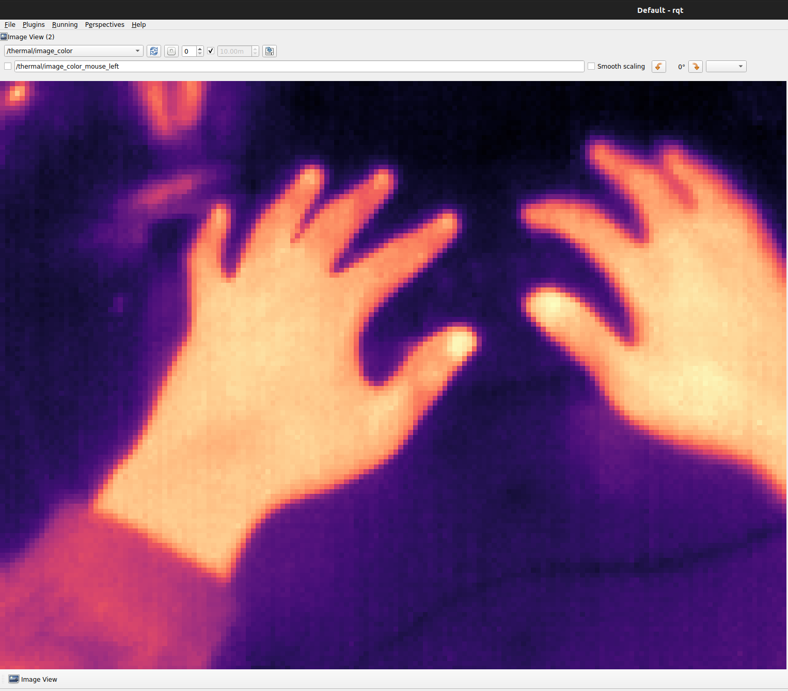

# thermoeye_ros2_driver

ThermoEye thermal camera integration for **ROS 2 Jazzy / Ubuntu 24.04**, using
TmSDK 2.1.0. The ROS package name is `thermal_cam_driver`.

The driver publishes thermal images, SDK temperature maps and camera information.
A Qt control window provides camera discovery, connection and measurement controls.
SDK binaries are obtained from the [official ThermoEye release](https://github.com/ThermoEye/TmSDK/releases/tag/2.1.0);
they are not included in this repository.

## Demo

Thermal image stream displayed in ROS 2.



## Install

Install ROS 2 Jazzy first and source its environment. Place the repository under
the `src` directory of a colcon workspace:

```bash
mkdir -p ~/thermal_ws/src
cd ~/thermal_ws/src
git clone https://github.com/mikissm/thermoeye_ros2_driver.git
cd thermoeye_ros2_driver
source /opt/ros/jazzy/setup.bash
./set.sh --install-deps
```

`set.sh` detects `amd64` or `arm64`, downloads the matching official SDK package,
and extracts it without installing the SDK system-wide. Its default location is
`$HOME/.local/opt/tmsdk/2.1.0`. To choose another directory:

```bash
./set.sh --sdk-dir "$HOME/opt/TmSDK/2.1.0" --install-deps
```

System dependency installation is opt-in with `--install-deps` and may use `sudo`.
Use `--yes` for noninteractive dependency installation. ROS itself must already
be installed. For an SDK package downloaded separately, use
`./set.sh --sdk-deb /path/to/tmsdk.deb`. `--rosdep` additionally resolves package
manifest dependencies through an already configured rosdep installation.
Run `./set.sh --help` for the complete options and prerequisites.

The installer generates `.tmsdk/env.sh` in this checkout. Source it in a terminal
before building or running the driver. Generated paths are local configuration
and should not be committed. After moving or changing the SDK directory, re-run
`set.sh`, source the regenerated environment, then rebuild with `--cmake-clean-cache` so CMake does
not retain the previous SDK paths. SDK paths containing a colon or newline are
not supported.

## Build

Build from the **workspace root**, not the repository directory:

```bash
cd ~/thermal_ws
source /opt/ros/jazzy/setup.bash
source src/thermoeye_ros2_driver/.tmsdk/env.sh
colcon build --packages-select thermal_cam_driver --cmake-clean-cache \
  --cmake-args -DCMAKE_BUILD_TYPE=Release
source install/setup.bash
```

CMake uses `TMSDK_ROOT` from the generated environment. An existing SDK extraction
can also be selected explicitly with `-DTMSDK_ROOT=/path/to/sdk`; it must contain
`usr/include` and `usr/lib/TmSDK`. SDK library paths are configured at build time
for the launch files and executable.

## Camera controls

Close other applications using the camera, then run:

```bash
source /opt/ros/jazzy/setup.bash
source ~/thermal_ws/src/thermoeye_ros2_driver/.tmsdk/env.sh
source ~/thermal_ws/install/setup.bash
ros2 launch thermal_cam_driver thermal_camera_manager.launch.py
```

Search for cameras, select the desired port and connect. Discovery reads the SDK
camera list without opening a camera; connection checks the selected port again
before opening it. In the default mode, start measurement after a fresh preview
arrives. With automatic FFC disabled, perform manual calibration and wait for
recovery and a fresh preview before starting measurement.

The window provides these choices (select the FFC mode before connecting):

- **Disable automatic FFC:** off by default, leaving the device's automatic
  calibration setting unchanged. Enabling it requests manual FFC after opening
  the camera and checks the setting. The manual calibration button is available
  only in this mode. Follow the camera manufacturer's calibration procedure.
- **Show preview:** on by default. Disabling it stops GUI image updates while
  measurement topic publication continues. It reduces display work, not camera
  acquisition or the cost of publishing ROS images.
- **Hide controls after measurement starts:** off by default. Enabling it hides
  the window after measurement starts and stops its ROS subscriptions and GUI
  timer. A lightweight process supervisor remains for logs and shutdown while
  the driver continues publishing. Stop with `Ctrl+C` in the launching terminal.

Selecting manual FFC cannot guarantee that camera firmware or the SDK will not
perform a correction during power-up or `Open`. The driver does not persist this
setting to camera nonvolatile storage. When manual FFC is selected, orderly
disconnection restores the original FFC mode and checks the result; restoration
cannot be guaranteed after a crash, forced termination or power loss. With the
default setting, the driver does not write the FFC mode. Software control of FFC
does not establish radiometric accuracy.

Disconnect waits for the child driver to finish shutting down before allowing
reconnection. Normal shutdown finishes the current frame request, stops acquisition,
unregisters SDK handlers and closes the camera. SDK/USB calls can delay shutdown;
ROS launch can escalate to termination after 45 seconds and forced termination
20 seconds later.

Driver output and shutdown diagnostics are saved under
`$ROS_LOG_DIR/thermal_manager_*.log`, or `~/.ros/log` when `ROS_LOG_DIR` is unset.

For launch without the manager window, use
`ros2 launch thermal_cam_driver thermal_camera.launch.py`. Its defaults leave
automatic FFC unchanged and do not open a calibration GUI. For explicitly
managed manual FFC, the node also exposes `disable_auto_ffc:=true`; prefer the
manager window for the guided workflow.

## Published data

| Topic | Type | Meaning |
| --- | --- | --- |
| `/thermal/image_color` | `sensor_msgs/msg/Image` | Colorized image, `bgr8` |
| `/thermal/temp_map` | `sensor_msgs/msg/Image` | SDK-reported Celsius, `32FC1` |
| `/thermal/min_temp` | `std_msgs/msg/Float32` | Minimum reported frame temperature |
| `/thermal/max_temp` | `std_msgs/msg/Float32` | Maximum reported frame temperature |
| `/thermal/camera_info` | `sensor_msgs/msg/CameraInfo` | Image dimensions; intrinsics are uncalibrated |
| `/thermal/ffc/status` | `std_msgs/msg/String` | JSON acquisition/calibration readiness state |

Image, temperature map and camera information share a per-frame ROS processing
timestamp and the `thermal_camera` frame. The timestamp is not a verified hardware
acquisition timestamp. Zero camera intrinsics do not represent a calibrated camera
model. Monitor message freshness as well as readiness status; status does not
retract previously published data or certify temperature accuracy. SDK conversion
failure can yield zero-valued data, so consumers must not interpret zeros alone
as a valid temperature measurement.

## Verification and limitations

The release targets Jazzy; changes should be built and tested on each deployment
architecture. Sensor-free tests exercise GUI and process shutdown behavior:

```bash
cd ~/thermal_ws
source /opt/ros/jazzy/setup.bash
source install/setup.bash
QT_QPA_PLATFORM=offscreen python3 -m unittest discover \
  -s src/thermoeye_ros2_driver/test -p 'test_*.py'
```

These tests do not validate camera operation, USB reliability, automatic correction
behavior, or temperature accuracy. Hardware verification must be performed for
the specific camera and host. This package does not provide RGB registration,
extrinsic calibration or a safety-rated temperature measurement system.

TmSDK is developed and distributed by ThermoEye under its own terms. This
repository contains the ROS integration layer; installing the SDK does not
change its license or provide redistribution rights.
